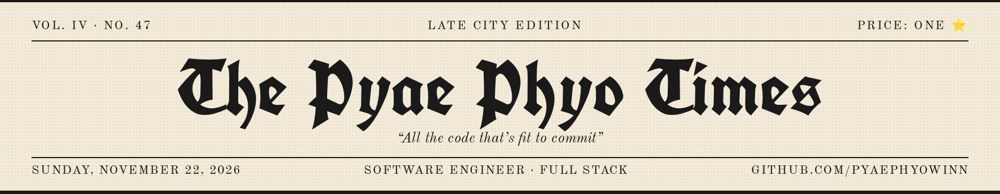
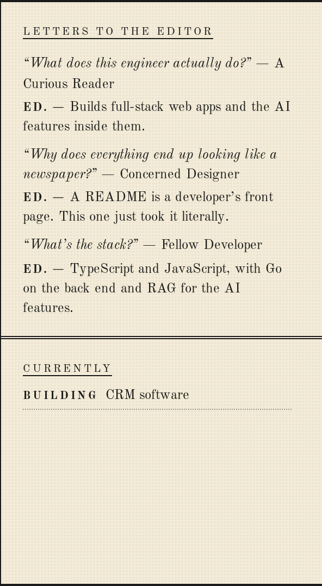
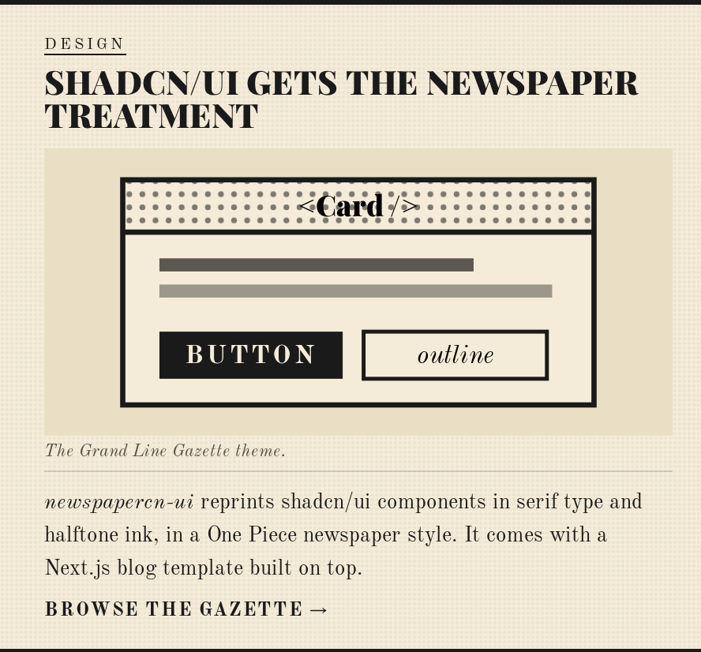
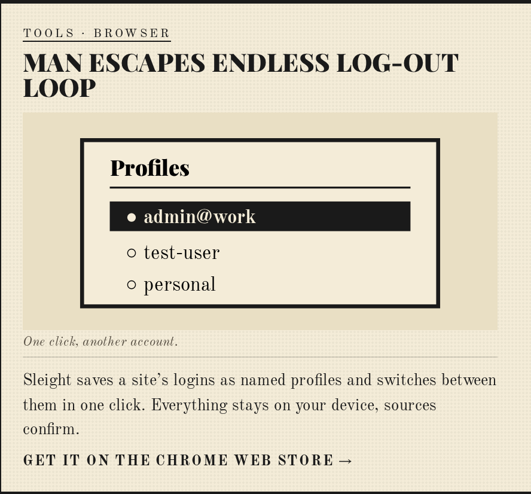
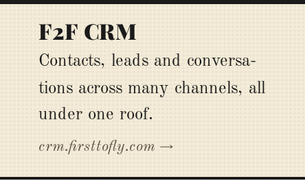
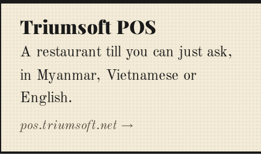
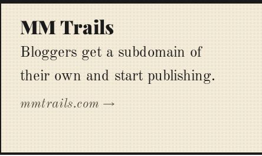
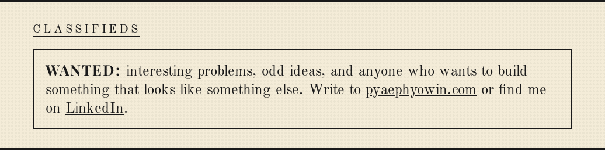
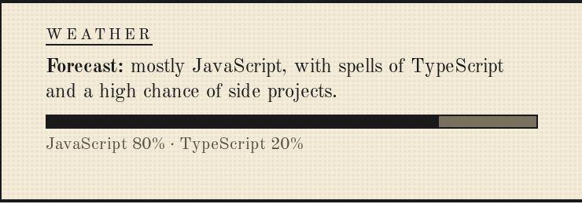

<!-- Generated by scripts/render.js from content.yml. Edit content.yml, not this file. -->

      

<a href="https://pyaephyowin.com">pyaephyowin.com</a> · <a href="https://www.linkedin.com/in/pyae-phyo-win-762792246/">LinkedIn</a>

